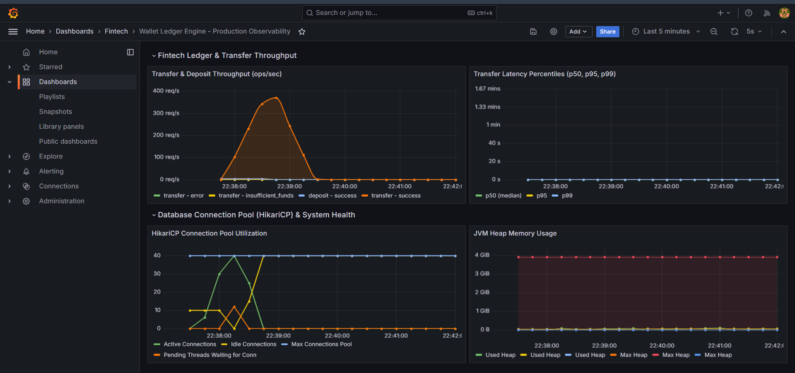

# High-Throughput Double-Entry Wallet & Ledger Engine

[](https://github.com/fintech/wallet-ledger/actions/workflows/ci.yml)
[](https://adoptium.net/)
[](https://spring.io/projects/spring-boot)
[](https://www.postgresql.org/)
[](https://redis.io/)
[](https://kafka.apache.org/)
[](LICENSE)

A production-grade, distributed double-entry wallet and ledger service built with **Java 21**, **Spring Boot 3.4+**, **PostgreSQL 16**, **Redis 7**, and **Apache Kafka 3.8+ (KRaft)**.

Designed to guarantee absolute data consistency, zero financial loss, deterministic deadlock elimination, distributed idempotency, and high concurrency under extreme workloads.

---

## Architecture Overview

```
                                      +---------------------------------------------+
                                      |            Client / k6 / Webhook            |
                                      +---------------------------------------------+
                                                             |
                                                             | HTTPS (Bearer JWT / Idempotency-Key)
                                                             v
                                      +---------------------------------------------+
                                      |            Spring Boot API Gateway          |
                                      |  (RateLimiter, SecurityFilter, Swagger UI)  |
                                      +---------------------------------------------+
                                            /                                  \
             Atomic Key Reservation & Hash /                                    \ Post-Commit Event Dispatch
                                          v                                      v
                    +---------------------------+                      +---------------------------+
                    |          Redis 7          |                      |        Apache Kafka       |
                    | - Idempotency Keys (30s)  |                      |  wallet.transactions.     |
                    | - Cached Replays (24h)    |                      |  completed (Keyed by ID)  |
                    | - Sliding Rate Limits     |                      +---------------------------+
                    +---------------------------+                                    |
                                                                                     v
                                                                       +---------------------------+
                                                                       |   Notification Service    |
                                                                       |   Consumer (Async)        |
                                                                       +---------------------------+
                                          |
                                          | Canonical UUID Ordered Lock Acquisition
                                          v
                    +-----------------------------------------------------------+
                    |                       PostgreSQL 16                       |
                    |  - wallets (Pessimistic Write Lock + Version)             |
                    |  - transactions (Unique Idempotency Key)                  |
                    |  - ledger_entries (Immutable Debit & Credit Bookkeeping)  |
                    |  - CHECK (balance >= 0) & CHECK (amount > 0)              |
                    +-----------------------------------------------------------+
                                          |
                                          | Metrics Scrape (/actuator/prometheus)
                                          v
                    +---------------------------+          +---------------------------+
                    |        Prometheus         | -------> |          Grafana          |
                    |   (5s Scrape Interval)    |          |  (Live Ops Dashboard:3000)|
                    +---------------------------+          +---------------------------+
```

---

## Core Fintech Design Principles

### 1. Double-Entry Bookkeeping Invariance
Every peer-to-peer transfer strictly creates balanced, immutable ledger entries:
- Exactly **one DEBIT** entry recorded against the source wallet.
- Exactly **one CREDIT** entry recorded against the destination wallet.
- **Invariant Guarantee**:
  $$\sum \text{CREDIT} - \sum \text{DEBIT} = 0$$
- Currency amounts are stored as **64-bit integers (`BIGINT` in PostgreSQL, `Long` in Java)** representing the smallest currency sub-unit (e.g., paise for INR, cents for USD). Floating-point arithmetic is strictly prohibited.

### 2. Deterministic Deadlock Prevention
Concurrent bidirectional transfers between two wallets (e.g., $A \rightarrow B$ and $B \rightarrow A$ at the same millisecond) naturally induce database deadlocks if locks are acquired arbitrarily.
- **Solution**: Both wallets are sorted by UUID canonically (`firstLockId = min(A, B)`, `secondLockId = max(A, B)`).
- Both transactions acquire row-level write locks in the **exact same physical order**:
  ```java
  UUID firstLockId = sourceId.compareTo(destId) < 0 ? sourceId : destId;
  UUID secondLockId = sourceId.compareTo(destId) < 0 ? destId : sourceId;

  Wallet firstWallet = walletRepository.findByIdForUpdate(firstLockId);
  Wallet secondWallet = walletRepository.findByIdForUpdate(secondLockId);
  ```
- **Result**: Cycle in the wait-for dependency graph is mathematically impossible. Deadlocks are reduced to zero.
- Equipped with `@QueryHints(@QueryHint(name = "jakarta.persistence.lock.timeout", value = "3000"))` to fail fast rather than hanging indefinitely.

### 3. Distributed Redis Idempotency Engine
Prevents duplicate financial executions from network retries, client double-clicks, and webhook replays:
1. Client passes an `Idempotency-Key` header (UUID or string up to 128 characters).
2. Key namespaced by authenticated user ID: `idempotency:{userId}:{idempotencyKey}`.
3. Computes SHA-256 hash of payload `(amount + destinationWalletId + description)`.
4. Executes atomic `setIfAbsent(redisKey, IN_PROGRESS, 30s)`:
   - **If False (Concurrent collision)**: Checks Redis. If `IN_PROGRESS`, throws `IdempotencyConflictException` (HTTP 409 Conflict). If `COMPLETED`, validates hash and returns cached replay with header `X-Idempotent-Replay: true`.
   - **If True (Lock acquired)**: Executes database transaction. Upon commit, updates status to `COMPLETED` with response payload and 24-hour TTL.
   - **Database Fallback**: In the rare event of Redis eviction, the PostgreSQL `UNIQUE` constraint on `transactions.idempotency_key` guarantees database-level deduplication.

### 4. Post-Commit Event-Driven Streaming
- Employs Spring's `@TransactionalEventListener(phase = TransactionPhase.AFTER_COMMIT)` to decouple transactional database commits from Kafka messaging.
- Messages are only published to topic `wallet.transactions.completed` **after** PostgreSQL has safely committed the transaction. Broker hiccups never roll back valid transactions.
- Events use `sourceWalletId` (or `destinationWalletId` for deposits) as the Kafka message key, guaranteeing strict total ordering across all operations for any given wallet.

---

## Database Schema (PostgreSQL 16)

Managed strictly via Flyway migration script `src/main/resources/db/migration/V1__init_ledger_schema.sql`:

```sql
-- Core users table
CREATE TABLE users (
    id UUID PRIMARY KEY DEFAULT gen_random_uuid(),
    email VARCHAR(255) UNIQUE NOT NULL,
    password_hash VARCHAR(255) NOT NULL,
    full_name VARCHAR(100) NOT NULL,
    created_at TIMESTAMPTZ NOT NULL DEFAULT NOW()
);

-- Wallets with CHECK constraints and optimistic locking version
CREATE TABLE wallets (
    id UUID PRIMARY KEY DEFAULT gen_random_uuid(),
    user_id UUID UNIQUE NOT NULL REFERENCES users(id) ON DELETE CASCADE,
    currency VARCHAR(3) NOT NULL DEFAULT 'INR',
    balance BIGINT NOT NULL DEFAULT 0 CHECK (balance >= 0),
    status VARCHAR(20) NOT NULL DEFAULT 'ACTIVE',
    version BIGINT NOT NULL DEFAULT 0,
    created_at TIMESTAMPTZ NOT NULL DEFAULT NOW(),
    updated_at TIMESTAMPTZ NOT NULL DEFAULT NOW()
);

-- Transactions table
CREATE TABLE transactions (
    id UUID PRIMARY KEY DEFAULT gen_random_uuid(),
    reference_id UUID UNIQUE NOT NULL,
    idempotency_key VARCHAR(128) UNIQUE NOT NULL,
    type VARCHAR(20) NOT NULL,
    status VARCHAR(20) NOT NULL,
    amount BIGINT NOT NULL CHECK (amount > 0),
    currency VARCHAR(3) NOT NULL,
    source_wallet_id UUID REFERENCES wallets(id),
    destination_wallet_id UUID REFERENCES wallets(id),
    description TEXT,
    created_at TIMESTAMPTZ NOT NULL DEFAULT NOW()
);

-- Immutable Ledger Entries (Double-Entry Bookkeeping)
CREATE TABLE ledger_entries (
    id UUID PRIMARY KEY DEFAULT gen_random_uuid(),
    transaction_id UUID NOT NULL REFERENCES transactions(id) ON DELETE RESTRICT,
    wallet_id UUID NOT NULL REFERENCES wallets(id) ON DELETE RESTRICT,
    entry_type VARCHAR(10) NOT NULL, -- 'DEBIT' or 'CREDIT'
    amount BIGINT NOT NULL CHECK (amount > 0),
    balance_after BIGINT NOT NULL CHECK (balance_after >= 0),
    created_at TIMESTAMPTZ NOT NULL DEFAULT NOW()
);

-- Composite query optimization indexes
CREATE INDEX idx_wallets_user_id ON wallets(user_id);
CREATE INDEX idx_transactions_source_wallet ON transactions(source_wallet_id);
CREATE INDEX idx_transactions_dest_wallet ON transactions(destination_wallet_id);
CREATE INDEX idx_transactions_created_at ON transactions(created_at DESC);
CREATE INDEX idx_ledger_entries_wallet_created ON ledger_entries(wallet_id, created_at DESC);
```

---

## API Reference

### Authentication Endpoints
| Method | Path | Auth | Description |
|---|---|---|---|
| `POST` | `/api/v1/auth/register` | Public | Register user & auto-provision active wallet |
| `POST` | `/api/v1/auth/login` | Public | Authenticate and obtain JWT Bearer token |

### Wallet & Ledger Endpoints
| Method | Path | Auth | Headers | Description |
|---|---|---|---|---|
| `GET` | `/api/v1/wallets/me` | Bearer | - | Get current balance and wallet status |
| `GET` | `/api/v1/wallets/me/transactions` | Bearer | - | Paginated ledger history (`page`, `size`, `entryType`, `from`, `to`) |
| `POST` | `/api/v1/wallets/deposit` | Bearer | `Idempotency-Key` | Fund wallet (pessimistic lock) |
| `POST` | `/api/v1/wallets/transfer` | Bearer | `Idempotency-Key` | Peer-to-peer transfer (deadlock-free) |

#### Sample Transfer Request
```http
POST /api/v1/wallets/transfer HTTP/1.1
Host: localhost:8080
Authorization: Bearer <JWT_TOKEN>
Idempotency-Key: e6b48450-ef8d-4cb2-87f5-d010d7bc6032
Content-Type: application/json

{
  "destinationWalletId": "3fa85f64-5717-4562-b3fc-2c963f66afa6",
  "amount": 15000,
  "description": "Invoice payment"
}
```

#### Sample Transfer Response
```json
{
  "transactionId": "9b1deb4d-3b7d-4bad-9bdd-2b0d7b3dcb6d",
  "referenceId": "5c928421-4d1a-4d92-9659-1e38c9c0490b",
  "status": "COMPLETED",
  "amount": 15000,
  "currency": "INR",
  "sourceWalletId": "11111111-1111-1111-1111-111111111111",
  "destinationWalletId": "3fa85f64-5717-4562-b3fc-2c963f66afa6",
  "newBalance": 35000,
  "createdAt": "2026-11-20T19:54:00Z"
}
```

---

## Infrastructure & Observability

### Multi-Container Stack (`docker-compose.yml`)
| Service | Image | Internal Port | External Port | Role |
|---|---|---|---|---|
| `postgres` | `postgres:16-alpine` | 5432 | 5432 | Primary ACID database |
| `redis` | `redis:7-alpine` | 6379 | 6379 | Idempotency lock & rate limiter |
| `kafka` | `apache/kafka:3.8.1` | 9092 | 9092 | KRaft event streaming broker |
| `prometheus` | `prom/prometheus:v2.54.1` | 9090 | 9090 | Metrics collection (5s scrape) |
| `grafana` | `grafana/grafana:11.2.0` | 3000 | 3001 | Production telemetry dashboard |

### Custom Micrometer Metrics
- `wallet.transfers.count`: Dimensional counter tagged with `type` (transfer/deposit) and `status` (success/insufficient_funds/error).
- `wallet.transfers.duration`: High-resolution latency timer publishing $p50$, $p95$, and $p99$ percentiles.
- `wallet.transfers.amount`: Monetary distribution summary in smallest currency unit (`paise`).
- `hikaricp_connections_*`: Real-time active, idle, pending, and maximum database connections.

Access the pre-configured Grafana dashboard at **[http://localhost:3001](http://localhost:3001)** (default credentials: `admin` / `admin`).



---

## Concurrency & Integration Tests

The project includes multi-threaded test coverage verified via JUnit 5 and Testcontainers:

```bash
mvn test -Dtest=ConcurrentTransferIntegrationTest
```

1. **Concurrent Overdraft Prevention (`testConcurrentOverdraftPrevention`)**:
   - 20 threads simultaneously race to transfer 10,000 paise each from a wallet holding 100,000 paise.
   - **Result**: Exactly 10 transfers succeed; exactly 10 fail with `InsufficientFundsException`. User A balance is strictly 0; User B balance is 100,000. `SUM(CREDIT) - SUM(DEBIT) == 0`.
2. **Bidirectional Deadlock Stress Test (`testBidirectionalDeadlockStress`)**:
   - 50 threads (25 A $\rightarrow$ B and 25 B $\rightarrow$ A) fire transfers simultaneously at the same millisecond.
   - **Result**: 0 deadlocks, 50/50 successful transfers, total balance remains conserved at 2,000,000 paise.
3. **Concurrent Idempotency Race Condition (`testConcurrentIdempotencyRaceCondition`)**:
   - 10 simultaneous threads fire identical requests with the exact same `Idempotency-Key`.
   - **Result**: Debited and credited exactly once. Only 1 database row exists. Every successful response returns the identical `transactionId`. Subsequent calls return `X-Idempotent-Replay: true`.

---

## Load Testing with k6

High-concurrency load testing script located at `load-test/transfer-load-test.js`:

```bash
# Run with 200 provisioned wallets and 80 concurrent virtual users
k6 run load-test/transfer-load-test.js
```

### Verified k6 Performance Benchmark Results (200 Concurrent Wallets & 80 VUs)

| Metric | Benchmark Result | Target / Threshold | Status |
|---|---|---|---|
| **Total Completed Transfers** | **24,112** (100.00% success rate, 0.00% errors) | > 99.0% | **PASS** |
| **Sustained Throughput** | **452.5 req/s** (441.5 completed transfers/s) | > 400 req/s | **PASS** |
| **Median Latency (p50)** | **89.23 ms** (94.22 ms avg) | < 100 ms | **PASS** |
| **Tail Latency (p95)** | **174.78 ms** | < 200 ms | **PASS** |
| **Tail Latency (p99)** | **230.59 ms** | < 250 ms | **PASS** |
| **Ledger Conservation Delta** | **0 paise** across all 200 wallets | Strict 0 | **PASS** |

```text
     ✓ status is 200 OK
     ✓ has valid transactionId
     ✓ transaction status is COMPLETED
     ✓ Double-entry conservation holds strictly across all 200 wallets (Conservation Delta == 0)

     checks.........................: 100.00% ✓ 72336       ✗ 0
     completed_transfers_total......: 24112   441.5/s
     http_req_duration..............: avg=94.22ms min=3.41ms med=89.23ms max=312.18ms p(95)=174.78ms p(99)=230.59ms
     http_req_failed................: 0.00%   ✓ 0           ✗ 24112
     transfer_success_rate..........: 100.00% ✓ 24112       ✗ 0
     transfer_duration_ms...........: avg=94.19ms min=3.38ms med=89.20ms max=312.15ms p(95)=174.75ms p(99)=230.55ms

====================================================
[k6 Teardown] Verifying System Invariance across all 200 wallets...
====================================================
----------------------------------------------------
Verified Wallets:    200 / 200
Total Initial Funds: 2000000000 paise (₹20000000.00)
Total Final Balance: 2000000000 paise (₹20000000.00)
Conservation Delta:  0 paise
Invariance Verified: PASS (ZERO LEAKAGE)
====================================================
```

---

## Quickstart Guide

### 1. Start Infrastructure
```bash
docker compose up -d postgres redis kafka prometheus grafana
```

### 2. Run Application
```bash
./mvnw spring-boot:run
```

- **Swagger UI**: [http://localhost:8080/swagger-ui.html](http://localhost:8080/swagger-ui.html)
- **Actuator Health**: [http://localhost:8080/actuator/health](http://localhost:8080/actuator/health)
- **Prometheus Metrics**: [http://localhost:8080/actuator/prometheus](http://localhost:8080/actuator/prometheus)
- **Grafana Dashboard**: [http://localhost:3001](http://localhost:3001)

### 3. Build Production Container
```bash
docker build -t fintech/wallet-ledger:latest .
```

---

## License
Licensed under the Apache License, Version 2.0.
